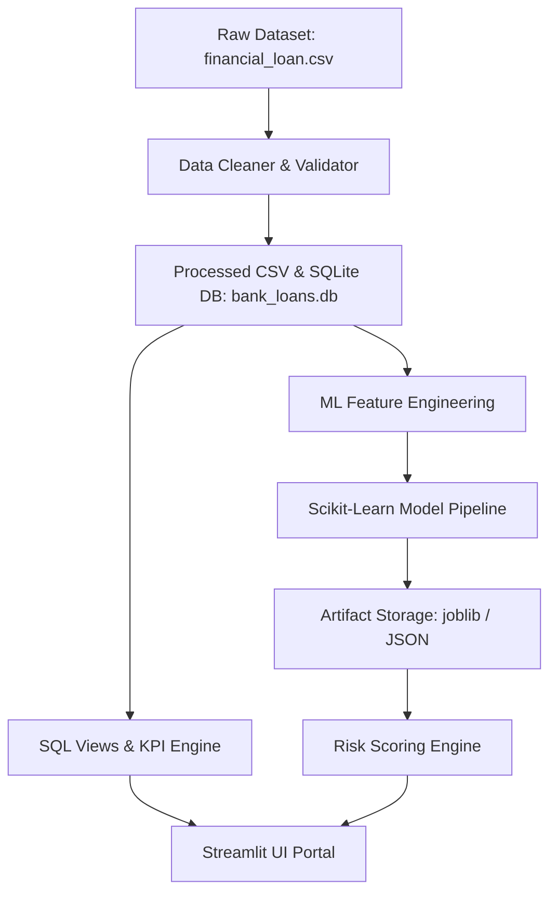
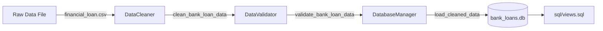
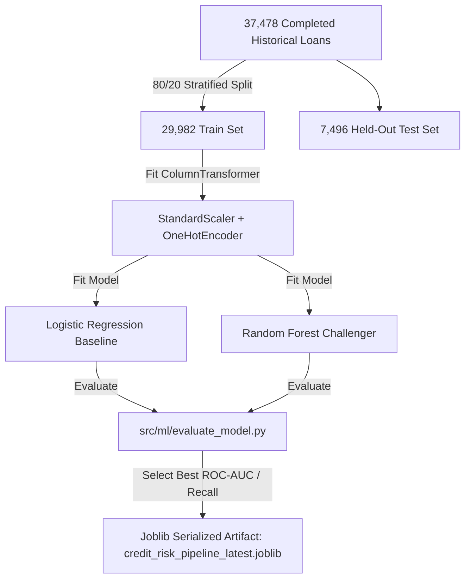
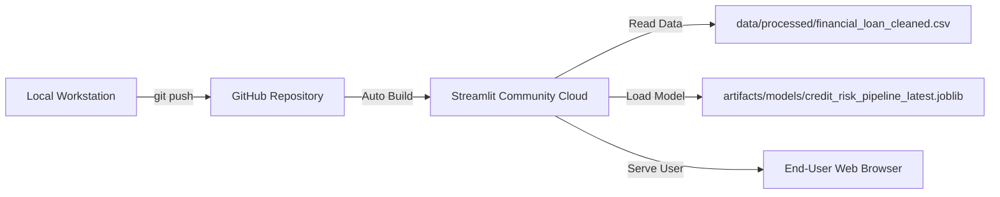

# Technical Architecture Specification

**Project Name:** AI-Assisted Bank Loan Analysis and Risk Intelligence Dashboard  
**Project Location:** `C:\Bank_loan_risk_analysis`  
**Application Entrypoint:** [app.py](file:///c:/Bank_loan_risk_analysis/app.py)  

---

## 1. System Overview

The system is engineered as a multi-tier, decoupled data analytics and machine learning application. It ingests raw bank lending records, performs schema validation and cleaning, loads structured data into SQLite databases (with optional MySQL interface support), computes domain financial KPIs and analytical database views, trains a scikit-learn credit risk classification pipeline, and exposes an interactive executive portal built with Streamlit and Plotly.



---

## 2. Technology Stack & Dependencies

- **Programming Language**: Python 3.14+
- **Data Manipulation & Computation**: Pandas (`>=2.0.0`), NumPy (`>=1.24.0`)
- **Database Layer**: SQLite 3 (native Python `sqlite3`), `mysql-connector-python` (optional secondary adapter)
- **Machine Learning**: Scikit-Learn (`>=1.3.0`), Joblib (`>=1.3.0`)
- **Visualization**: Plotly Express & Graph Objects (`>=5.15.0`)
- **Web Dashboard Framework**: Streamlit (`>=1.28.0`)
- **Automated Testing Suite**: PyTest (`>=7.4.0`)

---

## 3. Project Directory Tree

```
c:/Bank_loan_risk_analysis/
├── data/
│   ├── raw/
│   │   └── financial_loan.csv               # Verified raw dataset (38,576 records)
│   └── processed/
│       ├── financial_loan_cleaned.csv       # Cleaned dataset (38,576 records)
│       └── bank_loans.db                    # SQLite database (38,576 records)
├── sql/
│   ├── schema.sql                           # Table DDL & indexes
│   ├── kpi_queries.sql                      # Production SQL KPI queries
│   └── views.sql                            # 7 analytical database views
├── src/
│   ├── config.py                            # Constants, paths, state lookup maps
│   ├── database/
│   │   └── db_manager.py                    # SQLite connection lifecycle & loader
│   ├── data_processing/
│   │   ├── cleaner.py                       # Data cleaner pipeline
│   │   └── validator.py                     # Schema validator & quality score
│   ├── analytics/
│   │   └── kpi_engine.py                    # Analytical KPI Engine
│   ├── ml/
│   │   ├── feature_engineering.py           # Target mapping & leakage checks
│   │   ├── evaluate_model.py                # Classifier metrics & feature drivers
│   │   ├── train_model.py                   # Training pipeline & artifact output
│   │   └── risk_scoring.py                  # Single & batch scoring engine
│   └── ui/
│       ├── components.py                    # Banking CSS theme & Plotly charts
│       └── views/
│           ├── summary.py                   # Executive Summary view
│           ├── overview.py                  # Loan Overview view
│           ├── details.py                   # Filterable grid & CSV export view
│           └── risk_intelligence.py         # AI Underwriting & Feature Drivers view
├── tests/
│   ├── test_cleaner.py                      # Data cleaning unit tests
│   ├── test_validator.py                    # Validation unit tests
│   ├── test_db.py                           # Database manager unit tests
│   ├── test_kpi_consistency.py              # SQL vs Pandas cross-validation tests
│   ├── test_ml_pipeline.py                  # ML pipeline & leakage tests
│   ├── test_risk_scoring.py                 # Risk scoring engine unit tests
│   ├── test_ui.py                           # UI formatting & chart unit tests
│   └── test_phase6_integration.py           # System integration tests
├── artifacts/
│   ├── models/
│   │   ├── credit_risk_pipeline_v1.0.0.joblib # Serialized model pipeline
│   │   ├── credit_risk_pipeline_latest.joblib # Active model artifact
│   │   └── model_metadata.json              # Version & target metadata
│   ├── metrics/
│   │   └── evaluation_metrics.json          # Metrics comparison JSON
│   └── reports/
│       └── model_evaluation_report.md       # Markdown evaluation report
├── docs/
│   ├── Data_Dictionary.md                   # Column descriptions
│   └── Architecture.md                      # System architecture
├── app.py                                   # Streamlit main entrypoint
├── requirements.txt                         # Dependency manifest
├── PROJECT_PROGRESS.md                      # Development progress log
├── task.md                                  # Actionable task roadmap
├── design.md                                # UI/UX design specification
├── architecture.md                          # Technical architecture specification
└── README.md                                # Setup & usage documentation
```

---

## 4. Data Processing & Database Architecture

### Data Cleaning Pipeline ([src/data_processing/cleaner.py](file:///c:/Bank_loan_risk_analysis/src/data_processing/cleaner.py))
1. **Date Parsing**: Converts string dates (`dd-mm-yyyy`) in `issue_date`, `last_payment_date`, `next_payment_date`, and `last_credit_pull_date` into ISO `YYYY-MM-DD` and pandas datetime objects.
2. **State Name Imputation**: Imputes missing state names in `States` (38,476 nulls in raw CSV) using 2-letter `address_state` codes mapped against a 50-state lookup dictionary (`US_STATE_MAP` in [src/config.py](file:///c:/Bank_loan_risk_analysis/src/config.py)).
3. **Missing Employer Titles**: Fills missing `emp_title` values (1,438 nulls) with `'Unspecified'`.
4. **Numeric Extraction**: Extracts integer `term_months` (`36`, `60`) and `emp_length_years` (`0.0` to `10.0`).
5. **Standing Categorization**: Adds derived boolean `is_good_loan` and `loan_standing` (`Good Standing` for Fully Paid/Current, `Bad Standing` for Charged Off).
6. **Zero Record Loss**: Raw row count (38,576) == Cleaned row count (38,576).

### Database Schema & Views ([sql/schema.sql](file:///c:/Bank_loan_risk_analysis/sql/schema.sql) & [sql/views.sql](file:///c:/Bank_loan_risk_analysis/sql/views.sql))
Stored in SQLite database `data/processed/bank_loans.db`:
- **Table**: `bank_loans` (29 columns, primary key `id`, indexes on `loan_status`, `issue_date`, `address_state`, `grade`).
- **Views**:
  - `vw_monthly_trends`: Time-series monthly aggregations (`issue_month`, `total_loan_applications`, `total_funded_amount`, `total_amount_received`).
  - `vw_state_summary`: Geographic regional metrics by US state.
  - `vw_purpose_summary`: Financial aggregations by borrower loan purpose.
  - `vw_grade_summary`: Risk grade metrics (`A` to `G`).
  - `vw_term_summary`: Loan duration breakdown (36 vs 60 months).
  - `vw_emp_length_summary`: Aggregations by employment length.
  - `vw_home_ownership_summary`: Aggregations by home ownership status.



---

## 5. Machine Learning Pipeline Architecture

### Target Definition & Dataset Split ([src/ml/feature_engineering.py](file:///c:/Bank_loan_risk_analysis/src/ml/feature_engineering.py))
- **Target Mapping**: Binary target `target_default` (Positive Class `1` = `Charged Off`, Negative Class `0` = `Fully Paid`).
- **Active Loan Exclusion**: Excludes 1,098 active `Current` loans from model training to prevent label ambiguity. Training universe: 37,478 completed historical loans (32,145 Fully Paid vs 5,333 Charged Off).
- **Target Leakage Safeguards**: Strict feature allowlist enforcing 12 pre-origination underwriting features (`loan_amount`, `annual_income`, `dti`, `int_rate`, `emp_length_years`, `total_acc`, `term`, `grade`, `home_ownership`, `verification_status`, `purpose`, `address_state`). Prohibits post-outcome servicing fields (`total_payment`, `installment`, `last_payment_date`, etc.).
- **Train/Test Split**: 80/20 Stratified Train/Test split (`random_state=42`) yielding 29,982 training records and 7,496 test records.

### Model Training & Selection ([src/ml/train_model.py](file:///c:/Bank_loan_risk_analysis/src/ml/train_model.py))
- Fits scikit-learn `Pipeline` (`ColumnTransformer` + Classifier) **only on training data**:
  - Baseline: `LogisticRegression(class_weight='balanced', random_state=42)`
  - Challenger: `RandomForestClassifier(n_estimators=100, class_weight='balanced', random_state=42)`
- **Selected Model**: Logistic Regression Pipeline (Test ROC-AUC = `0.6953`, Default Recall = `65.23%`).
- **Artifact Output**: Serialized joblib pipeline saved to `artifacts/models/credit_risk_pipeline_v1.0.0.joblib` and `artifacts/models/credit_risk_pipeline_latest.joblib`.



---

## 6. Risk Scoring & Inference Engine ([src/ml/risk_scoring.py](file:///c:/Bank_loan_risk_analysis/src/ml/risk_scoring.py))

`CreditRiskScoringEngine` loads the serialized joblib pipeline and exposes two primary scoring interfaces:

1. `score_record(input_record: dict) -> dict`: Scores a single applicant record dictionary and returns:
   - `risk_probability`: Float probability `P(Default)` in range `[0.0, 1.0]`.
   - `risk_score_pct`: Percentage `P(Default) * 100.0`.
   - `predicted_class`: Binary class (`1` for High Default Risk, `0` for Standard Risk).
   - `risk_category`: Documented risk tier:
     - `Low Risk`: `P(Default) < 0.15`
     - `Medium Risk`: `0.15 <= P(Default) < 0.35`
     - `High Risk`: `P(Default) >= 0.35`
   - `model_version`: `"v1.0.0"`.
2. `score_batch(df_batch: pd.DataFrame) -> pd.DataFrame`: Performs batch inference across portfolio DataFrames and appends prediction columns.

---

## 7. Streamlit Application Execution Flow ([app.py](file:///c:/Bank_loan_risk_analysis/app.py))

```mermaid
graph TD
    Start[User Opens Web Browser] --> App[app.py Entrypoint]
    App --> Theme[apply_custom_css]
    App --> CacheData[@st.cache_data load_data]
    CacheData --> FilterSidebar[Render Sidebar Filters: State, Status, Grade, Purpose]
    FilterSidebar --> FilterApply[Apply Filters to Portfolio DataFrame]
    FilterApply --> Router{Sidebar Radio Selection}
    Router -->|📌 Executive Summary| View1[src/ui/views/summary.py]
    Router -->|📈 Loan Overview| View2[src/ui/views/overview.py]
    Router -->|📄 Detailed Loan Records| View3[src/ui/views/details.py]
    Router -->|🤖 Risk Intelligence| View4[src/ui/views/risk_intelligence.py]
    View4 --> ScoringEngine[CreditRiskScoringEngine]
```

---

## 8. Testing Strategy & Verification

The project includes an automated PyTest suite in `tests/`:
- `test_cleaner.py`: Date parsing, missing state imputation, numeric term extraction.
- `test_validator.py`: Schema enforcement, missing column detection, duplicate primary key checks.
- `test_db.py`: SQLite initialization, bulk loading, error handling.
- `test_kpi_consistency.py`: Direct SQL query vs Pandas `KPIEngine` cross-validation (0 numeric discrepancy).
- `test_ml_pipeline.py`: Target mapping, feature allowlist integrity, target leakage assertions, preprocessor fitting.
- `test_risk_scoring.py`: Single record scoring, risk tier assignment, leakage field ignoring, batch scoring.
- `test_ui.py`: Number formatting helpers and Plotly chart generators.
- `test_phase6_integration.py`: Model explainability extraction, unseen categorical value inference, database resource cleanup.

**Test Results**: All **37 unit and integration tests passed** in **5.42s** (100% pass rate).

---

## 9. Local Execution & Deployment Architecture

### Verified Local Configuration
- **Dataset**: `data/raw/financial_loan.csv`
- **Database**: SQLite database file at `data/processed/bank_loans.db`
- **Model Artifact**: Serialized joblib file at `artifacts/models/credit_risk_pipeline_latest.joblib` (6.8 KB)
- **Local Startup Command**:
  ```powershell
  streamlit run app.py
  ```

### Proposed Cloud Deployment Architecture (Streamlit Community Cloud)
- **Git Repository**: GitHub repository containing full source code and directory layout.
- **Model Artifact Persistence**: Joblib model file (`6.8 KB`) committed directly to Git repository (well within GitHub 100 MB limit).
- **Data Persistence Strategy**: Cleaned dataset (`financial_loan_cleaned.csv`) committed to `data/processed/`. `app.py` auto-initializes the SQLite database in `data/processed/bank_loans.db` on first boot if missing.
- **Cloud Configuration**: `.streamlit/config.toml` configuring corporate dark theme settings.



---

## 10. Security, Privacy & Operational Risk Controls

1. **Secret & Credential Protection**: No hardcoded API keys, database credentials, or passwords exist in source code. `.gitignore` excludes local environment files.
2. **Zero Synthetic Data Policy**: Strictly operates on authentic loan performance records. No mock or fake records generated.
3. **Underwriting Decision Support Disclaimer**: Explicitly documented in UI that credit risk scores represent learned historical associations for decision support, not binding or automated lending decisions.
